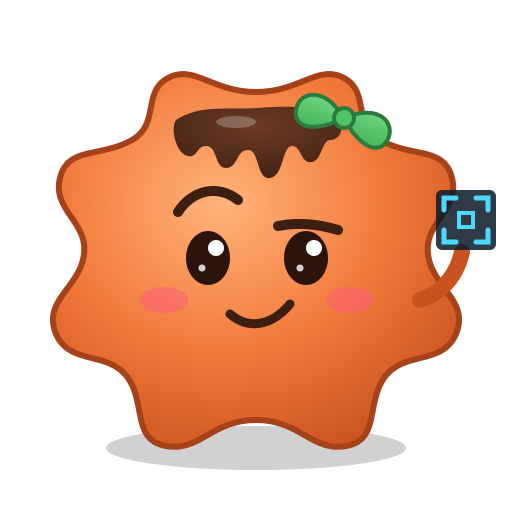

<!-- eden-kledd fork header -->

  

<h1 align="center">eden-kledd</h1>

<b>An unofficial fork of <a href="https://git.eden-emu.dev/eden-emu/eden">Eden</a>.</b> 
Not affiliated with or endorsed by the Eden team. Please don't report bugs from this build to them.

> [!IMPORTANT]
> The only official Eden source is [git.eden-emu.dev/eden-emu/eden](https://git.eden-emu.dev/eden-emu/eden).
> This repository is a personal test fork. Everything below the line is Eden's own README, kept for credit and reference.

## What this fork changes

**Fixes the Metroid Prime 4: Beyond scan visor jumping between targets / locking onto things behind walls.**

The game reads back a small depth-stencil patch around the crosshair (the stencil holds object IDs) to decide what you're aiming at.
In Eden's Vulkan backend, downloading a `D24S8` image created the depth and stencil copy regions at the **same buffer offset**, so the two
writes overlapped and the object IDs came back garbled. This fork downloads depth and stencil into separate regions, merges them back into
the guest format on the CPU, and does it asynchronously and only for the requested region, so there's no FPS cost.

The fix is behind two options under **Properties → Ext. Graphics**:
- `[Kledd] DMA readback fix`: turns the fix on
- `[Kledd] DMA readback log`: debug logging (leave off for normal play)

Tested on Windows with an RTX 2060 Mobile (6GB VRAM), in both Accurate and Fast GPU mode.

## Verify the build yourself

- All changes are in this repository's commit history, on top of upstream Eden snapshot `d8c6c59b6`.
- Windows builds are made by **GitHub Actions** from this public source (see the [Actions tab](../../actions) and
  `.github/workflows/build-windows.yml`). Nothing is built or uploaded by hand.
- The commit hash in Eden's title bar matches the commit the build came from.

## Credits

- **Eden team** and yuzu contributors: the emulator itself.
- **Melos**: testing, investigation, and pointing at the depth buffer.
- **Claude (Anthropic AI), a.k.a. Kledd**: reverse engineering, root-cause analysis and the patch. This fork was made with AI assistance.

---

<!--
# SPDX-FileCopyrightText: Copyright 2025 Eden Emulator Project
# SPDX-License-Identifier: GPL-3.0-or-later

# SPDX-FileCopyrightText: 2018 yuzu Emulator Project
# SPDX-License-Identifier: GPL-2.0-or-later
-->
<!-- lang: en-GB -->

<h1 align="center">
   
  
   
  <b>Eden</b>
   
</h1>

<h4 align="center"><b>Eden</b> is a free and open-source (FOSS) Switch 1 emulator started by developer Camille LaVey.
 
Written in C++, with builds for Windows, Linux, macOS, Android, FreeBSD and more.
</h4>

    </a>
    
    

  <a href="#compatibility">Compatibility</a> |
  <a href="#development">Development</a> |
  <a href="#building">Building</a> |
  <a href="#download">Download</a> |
  <a href="#support">Support</a> |
  <a href="#license">License</a>

## Compatibility

The emulator is capable of running most commercial games at full speed, provided you meet the necessary hardware requirements.

A list of supported games will be available in future. Please be patient.

Check out our [website](https://eden-emu.dev) for the latest news on exciting features, monthly progress reports, and more!

## Contribute

To contribute to Eden; be it financially, code, bug reports, or otherwise, see our [Contributing guidelines](./CONTRIBUTING.md).

## Documentation

We have a user manual! See our [User Handbook](./docs/user/README.md).

## Building

See the [General Build Guide](docs/Build.md)

For information on provided development tooling, see the [Tools directory](./tools)

## Download

You can download the latest releases from [our release page](https://git.eden-emu.dev/eden-emu/eden/releases).

Save us some bandwidth! We have [mirrors available](./docs/user/ThirdParty.md#mirrors) as well.

## License

Eden is licensed under the GPLv3 (or any later version). Refer to the [LICENSE.txt](https://git.eden-emu.dev/eden-emu/eden/src/branch/master/LICENSE.txt) file.

## Special thanks

Super special thanks to Cloudflare for preventing the git server from blowing up.

- Yuzu
- Ryujinx
- Sudachi
- Citron
- Torzu
- Suyu
- Ryubing

And everyone who continues or had contributed to the project! <3
